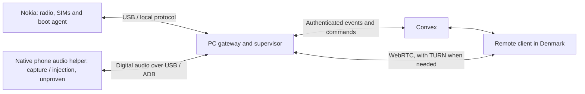

# Nokia 8110 cellular gateway plan

Recorded: 2026-10-12. This is a design and investigation plan, not authorization to flash firmware or execute cellular commands.

## Purpose and operating arrangement

The Nokia will stay in Bangladesh while its owner is in Denmark. It will provide remote access to the Robi and Teletalk SIMs through a permanently attached computer.

- Device: Nokia 8110 4G, TA-1059, currently running stock KaiOS. Reported software version: `12.00.17.10`.
- The phone generally works well and gets little use. LTE no longer works; Wi-Fi works.
- The owner confirmed working SIMs, SMS, normal incoming/outgoing voice calls, keypad tones and interactive USSD on both SIMs on 2026-10-12. These are manual phone tests, not verification of remote controls or bridged audio.
- The phone is connected to the computer through USB/ADB. The owner rejected the headset-port hardware bridge; the next experiment is native software access to cellular call audio.
- Convex will replace the current PC-only backend later. The existing local setup remains the proof of concept.
- The future health/reconciliation interval is one minute. Incoming SMS and call events should be delivered immediately.
- The owner will maintain SIM validity manually; automatic recharge/validity management is outside this plan.

## Required capabilities

1. Receive SMSes and synchronize them to Convex, retaining the existing sent-SMS support.
2. Report incoming calls immediately and trigger push notifications through an HTTP request or backend integration.
3. Select a SIM and remotely make, answer and end calls; send SMSes; dial USSD codes; display USSD responses; reply to menus and cancel sessions.
4. Bridge cellular call audio through the attached computer to a remote browser or application.
5. Run a phone agent that communicates with the connected computer, starts automatically at boot and needs no routine interaction on the phone.

## Proposed architecture

### Phone

Use a GerdaOS-based image retaining the working cellular and audio stack. A boot-started agent exposes defined local operations to the computer and reports events and health.

Keep the existing Gecko/B2G, vendor radio services, SIM management, SMS database and audio services initially. A minimal or blank device interface is acceptable. Remove consumer applications progressively; preserve required system handlers until replacements are proven.

Use a dedicated local protocol over USB/ADB rather than depending on repeated Gecko debugger sessions. The current debugger sometimes rejects subsequent connections until a full phone reboot.

Keep a persistent event/upload queue on the phone so computer or transport interruptions do not discard messages. Include SIM identity in new records and operations so Robi and Teletalk can be distinguished.

### Attached computer

A supervised service will:

- Maintain the USB connection and recreate required forwarding/reverse tunnels after reconnects and reboots.
- Communicate with the phone agent and maintain a durable local queue while internet access is unavailable.
- Synchronize SMSes, events and command results with Convex.
- Execute authenticated, SIM-specific commands and report their outcomes.
- Monitor the phone agent, ADB, SIM registration and queue progress.
- Recover stalled components with bounded retries and escalation, avoiding unnecessary disruption of active calls or USSD sessions.
- Exchange digital call audio with a native phone helper over USB/ADB and manage the remote media connection, conditional on proving capture and injection on this firmware.
- Start automatically after a computer reboot without requiring an interactive login.

The computer can provide the internet path, making cellular data on the Nokia optional. Phone Wi-Fi can remain available, but independent phone-to-cloud access is not required for this arrangement.

### Convex and remote client

Convex will hold the SMS archive, device state, command records, USSD responses and call metadata. The remote client will display messages, receive notifications and expose call and USSD controls.

Use authenticated backend endpoints and command access. Device credentials and remote user authentication should have separate responsibilities.

Commands need identifiers, explicit SIM selection, expiry, execution state and result reporting. A timeout after a carrier operation can mean the outcome is unknown; do not blindly repeat calls, SMS sends or USSD operations.

Continuous call audio uses a separate WebRTC media path. Convex can coordinate call state and signaling; it is not the audio transport. Include TURN relay support for networks that prevent a direct connection.

## Audio bridge

The owner replaced the headset-port experiment with a software audio feasibility test on 2026-10-12. No analog headset adapter or internal microphone/speaker wiring is planned.

The proposed path is cellular call audio ↔ native phone helper ↔ digital transport over USB/ADB ↔ PC ↔ remote WebRTC client. Wi-Fi or direct phone-to-internet transport can be considered later; neither solves access to the cellular audio streams by itself.

Read-only inspection of the saved stock system image found:

- `AUDIO_DEVICE_IN_VOICE_CALL` in `/system/etc/audio_policy.conf`.
- Call recording routes including `incall-rec-downlink`, and injection routes `incall_music_uplink` and `incall_music_uplink2` in the mixer configuration files.
- Corresponding recording and injection function names in `/system/lib/hw/audio.primary.msm8909.so`.
- Native `tinycap`, `tinyplay` and `tinymix` utilities in `/system/bin`.
- Properties disabling ordinary voice/playback, voice/recording and voice/VoIP concurrency in the saved property report.

These are feasibility clues, not proof of working two-way audio or identification of the live PCM devices and mixer routes. Related Qualcomm source restricts an older in-call music implementation to local-hold sessions; injection during a normal active call must be tested explicitly. Root/native access, audio policy changes or a targeted native modification may be needed. Merely recording the microphone or selecting a KaiOS telephony playback channel does not establish a cellular audio bridge. ADB will transport the helper's audio; it does not expose call audio automatically.

Initial live read-only ADB inspection on 2026-10-12 confirmed sound card `msm8909-skub-snd-card` and `/proc/asound/pcm` entries for `CS-Voice`, `Voice2`, `Voice Uplink Capture`, `Voice Downlink Capture`, `Voice Farend Playback` and `Voice2 Farend Playback`. These names include backend endpoints and do not establish directly usable userspace streams. The current ADB shell runs as UID 2000 without the audio group; sound device nodes belong to `system:audio`, and `tinymix` reports `Failed to open mixer`. Temporary native/root access is the next prerequisite for inspecting actual mixer controls. No call was placed, audio stream opened or mixer control changed during this inspection.

The owner subsequently enabled the existing temporary root access page. Root access and mixer reads now work. The live mixer has 875 controls, including downlink/uplink recording routes for MultiMedia1, MultiMedia4 and MultiMedia8, and two sets of in-call injection routes for MultiMedia1, MultiMedia2, MultiMedia5 and MultiMedia9. The initial values of these routes were Off, with `Voc VSID` at -1. Evidence is saved under `data/audio-probe/`; downlink capture is now verified below, while injection remains unproven.

The first bounded experiment is prepared in `tools/capture_call_audio.sh`, deployed to `/data/local/tmp/kaiforward-capture-call-audio.sh`. It requires a manually connected call, refuses an existing MultiMedia1 capture route/stream, enables only the MultiMedia1 downlink recording route, records 5–15 seconds using `tinycap`, and restores the previous route on exit. It includes independent capture time bounds and saves private WAV/mixer evidence on the phone. Shell syntax checks passed on the PC and phone; an idle-phone execution refused to run before any mixer change, and the controls remained unchanged. Injection follows after capture inspection and identification of the active voice session.

During an owner-connected Robi test call on 2026-10-12, this experiment recorded 96,000 frames: 12 seconds of mono, 8 kHz, 16-bit PCM. The file is `data/audio-probe/downlink-20261012-165925-9764.wav`, with before/after mixer snapshots and a JSON signal summary alongside it. It contains non-silent audio (peak 24,260; RMS approximately -26.51 dBFS) with no clipped samples. MultiMedia1 microphone/uplink capture routes were Off; only the downlink route was enabled by the experiment, then restored to Off, and the capture PCM closed afterward. The owner listened and confirmed hearing the remote caller counting. This establishes digital cellular downlink capture on Robi, not yet two-way audio, continuous streaming or Teletalk support. The owner also reported that the call disconnected around this experiment; timing and cause are not established, so call stability must be checked in subsequent tests.

The first injection test is prepared in `tools/inject_call_audio.sh`, deployed to `/data/local/tmp/kaiforward-inject-call-audio.sh`, with a six-second synthesized phrase, "Kai Forward audio test. One, two, three." The WAV is mono, 48 kHz, 16-bit PCM, matching `pcm_config_incall_music` inspected in the stock native library. The previous Robi call's active routes were VoiceMMode1, making native `voice1` the first candidate; native session selection is not a fixed SIM/carrier mapping. The test uses MultiMedia2 playback and the selected `Incall_Music` route, refuses existing playback streams/routes, bounds playback with independent watchdogs and restores the previous mixer value. Shell syntax checks passed on the PC and phone; an idle execution refused before changing any route, and injection controls remained Off. The caller must confirm hearing the phrase, and the call must remain active rather than held, before treating injection as proven.

After an owner-initiated full phone reboot on 2026-10-12, ADB returned with boot completion reported, but the temporary root service and USB tunnels were gone, and the test scripts/WAV in `/data/local/tmp` had been removed. The PC copies and saved recording remained available. The tests were redeployed and tunnels restored; temporary root must be enabled again on the phone. Treat `/data/local/tmp` as disposable on this firmware and place a future boot agent in persistent storage or arrange automatic reprovisioning after reboot.

The first Robi injection attempt then lost its root connection before returning a result, and the owner reported that the phone restarted. The exact failing stage is unknown: enabling the injection mixer versus opening/playing the PCM stream. Injection is not verified. Post-restart ADB inspection found no `/proc/last_kmsg` or `/sys/fs/pstore`; the available kernel log was saved privately under `data/audio-probe/restart-kernel-log.txt`, but does not establish the previous restart's cause. The owner explicitly requested one repeat of the same test. The injection script now prints phase markers, and `tools/root_shell.py --stream` preserves completed output lines on the PC before a disconnect. Fragmented output/completion and early-disconnect streaming checks passed locally. The same six-second phrase, route and PCM settings are redeployed; USB tunnels are restored, with phone-side temporary root and a new manual call required for the retry.

The authorized repeat on a newly connected Robi call completed on 2026-10-12: the route enabled, six seconds of mono 48 kHz playback completed, the route was restored, and the script returned exit code 0. Progress is saved in `data/audio-probe/injection-retry-progress.txt`; mixer snapshots and post-test state use prefix `data/audio-probe/injection-voice1-20261012-172522-5674`. Both injection controls returned to Off, the MultiMedia2 playback PCM closed, and VoiceMMode1 remained RUNNING afterward. No restart occurred during this repeat. The owner reported that the caller did not hear the phrase: successful native PCM playback did not establish audible uplink injection. The exact source WAV, `data/audio-probe/injection-test.wav`, was provided for PC playback verification before further diagnosis. The first attempt's restart remains unexplained.

The owner confirmed that the source WAV sounds correct on the PC, ruling out a silent or incorrect test file. Read-only follow-up found `Playback 1 Volume` at 0 with its PCM closed, but related driver source and live kernel messages show this control only reports/sets an open PCM runtime: closed-stream values are not evidence that playback was muted. Related kernel source maps VoiceMMode1 to the first injection backend, so no session mismatch has been established. The follow-up kernel log is saved as `data/audio-probe/post-injection-kernel-log.txt`; it does not establish an injection-specific DSP failure.

The gain diagnostic is `/system/bin/sh /data/local/tmp/kaiforward-inject-call-audio.sh voice1 half`. It waits for MultiMedia2 playback to reach RUNNING, records the live PCM parameters and gain, and explicitly sets per-stream gain to 4096 out of 8192 during the same six-second phrase. It saves a mixer snapshot during playback, retains the existing bounds/route restoration, and restores gain on failure if the stream remains open; normal PCM closure discards the per-stream setting. This is a gain/routing experiment, not a confirmed fix. PC and phone syntax checks and the idle-call refusal check passed, with injection routes remaining Off.

On a new owner-connected Robi call on 2026-10-12, the gain diagnostic completed with exit code 0. It measured live `Playback 1 Volume` at 0 after the PCM reached RUNNING, then set and read back 4096. Live parameters confirmed mono, 48 kHz, 16-bit PCM, a 240-frame period and a 480-frame buffer. Playback finished after six seconds; the route returned to Off and its PCM closed, while VoiceMMode1 remained RUNNING. Progress is saved in `data/audio-probe/injection-half-gain-progress.txt`; mixer before/during/after snapshots, live PCM status and post-test state use prefix `data/audio-probe/injection-voice1-20261012-173431-6370`. The owner confirmed that the caller still heard no phrase, so explicit gain did not establish audible injection.

Exact-firmware diagnosis subsequently identified a session-selection mismatch: the stock kernel's `voc_start_playback` selects legacy Voice/Voice2 and VoLTE sessions, but omits VoiceMMode1/VoiceMMode2. The observed Robi calls use VoiceMMode1. The live boot partition checksum matches the inspected backup, and the stock session lookup does recognize VoiceMMode sessions separately. This is the leading explanation for silent playback, pending proof from a corrected native implementation. See [CALL_AUDIO_FINDINGS.md](CALL_AUDIO_FINDINGS.md) for disassembly evidence, limitations and the proposed correction. Further file/volume retries do not address this omission. A corrected experimental boot/system image was subsequently installed but failed to boot; the owner reports normal boot after original stock restoration. Native session support remains unproven on the phone.

First prove digital capture of the remote caller's voice, then inject a known recording that the caller can hear without acoustic coupling through the phone's speaker/microphone. Prove simultaneous capture and injection during a normal active call on each SIM. A successful recording-only test or injection that works only while held is insufficient.

Start with one active bridged call at a time. Verify stability, latency, clipping, echo, local microphone/speaker behavior, call-state transitions and recovery after reboot. Remote answer/hang-up and DTMF remain separate integration tests. Full remote voice remains conditional on this experiment; SMS, USSD, notifications and call control can proceed independently.

## Native UI/SMS implementation, 2026-10-13

The native browser call relay is now installed and verified on SIM 2.
The owner answered through http://127.0.0.1:8768, confirmed simultaneous
two-way audio over Wi-Fi, and ended the call through the browser. The corrected
VoiceMMode kernel boots with the working native ramdisk and matching modules.
Both PCM streams and capture/injection routes release after hangup. Native
SMS forwarding remains active; modem and calibration partitions are unchanged.
See [call relay usage and validation](firmware/CALL_RELAY.md).

The native SMS bootstrap was implemented in `firmware/native`
and prepared in `dist/gerda-native-20261013-permission`; the current complete
call/SMS variant is `dist/gerda-native-calls-20261013`. A C framebuffer/keypad interface
provides status and editable Wi-Fi/receiver settings; separate native init
services own the RIL sockets, persist SMS before modem acknowledgement and
forward over Wi-Fi with receiver acknowledgement checks. A native send command
archives successful sends and retains uncertain results without automatic
resubmission. SIM slot metadata is retained by the receiver. The browser UI
and its radio client are disabled in this variant.

The build retains Gerda's upstream kernel and modules, and is independent of
the earlier failed audio experiment. The owner installed the native variant.
Its first-build recovery loop was traced to root-directory traversal
permissions (`0700` from host staging) and corrected permanently. Boot and all
native services, Wi-Fi network scanning/association, DHCP/netd routing/DNS,
and verified HTTPS access to the PC passed after a full reboot. The PC has
an additional authenticated HTTPS receiver at its LAN address on port 8767.
Fresh userdata/cache backup completion was confirmed by the owner, who waived
PC copying/verification. A real SIM 2 carrier SMS was received and archived on
the PC; SIM 1 now reports absent. Incoming-call setup revealed mediaserver
waiting for Gecko's SurfaceFlinger service, then blocking QCRIL on audio.
Native startup supplies the existing Gerda display service as kf-display.
A subsequent call stalled during an audio permission check; the new native
kf-permission controller grants only the system/radio stack's audio-settings
access. Registering it released hangup and the pending SMS without restarting
RIL, and the second carrier SMS was archived over Wi-Fi. Both Binder providers
and SIM registration work after reboot. The owner confirmed call hangup clears
the banner and Received reaches 3; all three messages are archived on the PC. The status UI now
shows received counts and incoming-call notifications. The original failed
native build and earlier boot/system packages are superseded.
See [native implementation and configuration](firmware/NATIVE_UI.md) for the
artifacts, limitations and hardware validation sequence.

## GerdaOS findings and firmware boundaries

GerdaOS is a plausible base because it previously worked on this phone, its documentation includes TA-1059 support, and its boot properties enable persistent ADB and root access. The upstream GitLab project is archived, so a custom gateway fork would need its own maintenance.

The build recipe primarily assembles/repackages existing system components. Replacing the complete radio/framework stack with a new headless OS would be a much larger undertaking than adding an agent and simplifying the existing system.

Read-only comparison on 2026-10-12 of the upstream `src/boot/8110/zImage` (kernel `3.10.49-ged30a3a-00776-g1f10757`, built 2018-10-26) found the same playback session-selection omission as this phone's stock kernel: its function selects Voice/Voice2 and VoLTE, omitting VoiceMMode1/VoiceMMode2. The image hash and disassembly are recorded in [CALL_AUDIO_FINDINGS.md](CALL_AUDIO_FINDINGS.md). Gerda's root/ADB defaults and editable startup services help gateway deployment, but the inspected standard image does not include the proposed injection correction. Plan a custom native/kernel fix rather than treating a Gerda installation as the audio experiment's solution.

The standard Gerda installer writes `boot`, `system`, `splash`, `modem`, `fsg` and `rpm`, and overwrites `modemst1` and `modemst2`. Do not use the generic deployment recipe without an explicit partition plan. Establish a compatible boot/system/modem combination and preserve device-specific radio data. Gerda installation is not established as a fix for the current LTE problem.

Review Gerda's permissive defaults when producing the custom image. Keep recovery access on the trusted USB connection and expose only authenticated, defined operations to the remote client.

### Custom build preparation

The owner authorized preparing and installing a custom Gerda build with the targeted playback correction. The microSD card is prepared and inserted. The implementation, pinned source inputs, PC build tools, static checks, and installation/recovery procedure are in [firmware/README.md](firmware/README.md). The corrected kernel and matching modules compiled, but the installed experimental system repeatedly returned to stock recovery. Audible injection remains unverified. Original stock boot/system were subsequently restored; the owner reports correct boot, the original wallpaper and Robi detected on 2026-10-13. Teletalk was intentionally removed and is not currently under test. Restored firmware and normal Robi operation were subsequently verified as recorded below; further firmware trials require a narrower change and compatibility assessment.

The experimental package targets only boot/system and retains stock recovery and device-specific radio partitions. Separate signed packages prepare an offline userdata/cache backup on FAT32 microSD and restore original boot/system or userdata/cache. Stock recovery's saved trusted key matches the signing certificate, and the backup/restore scripts refuse mounted data filesystems in live ARM checks. The original 30-partition firmware backup and a fresh replacement pass checksum checks; the interrupted `20261012-182517` copy is damaged and must not be used.

The first recovery backup stopped at the legacy updater's live device-property assertion. Version 2 reads the inspected recovery `/default.prop` directly and successfully completed the offline backup. PC copies under `backups/TA-1059-offline-userdata-20261012-232909` match the recovery SHA-256 hashes and exact userdata/cache partition sizes. Both original filesystem images have only the old formatter's unused inode-bitmap padding issue; disposable copies check clean after padding-only correction, while original backup hashes remain unchanged. The owner confirmed recovery button entry without ADB. After the authorized experimental installation failed to boot, earlier stock restore attempts aborted before opening the package while recovery reported battery capacity `0` with status `Full`. Cold recovery could run a small diagnostic; its logs show the recovery partition still matched its original backup. A small `05-restore-stock-sd.zip` was staged with separately hash-verified original boot/system images on the card, then used before the owner reported normal boot. It verifies sources and target sizes before writing, restores and checks system before boot, and preserves userdata/cache/radio/recovery. Saved restore logs and post-restore firmware were subsequently inspected as recorded below.

Post-restore ADB inspection on 2026-10-13 confirms the original firmware (`12.00.17.10`, incremental `12.00.17.06`), original kernel and completed boot. The imported recovery restore log confirms both original raw-target readback hashes, and the owner confirms normal two-way Robi call audio. Evidence is recorded in `data/gateway-build/stock-restore-result-20261013.json`. Teletalk remains intentionally removed. A compatibility review finds matching boot addresses/device trees and only release-metadata config differences, so the failed experimental boot remains unexplained. Any further audio correction should isolate changes against the working stock ramdisk/userspace rather than replacing kernel, ramdisk and system together. Digital uplink injection remains unproven.

## Current proof-of-concept evidence and limitations

The installed KaiForward app has copied 3,435 received SMSes and 10 sent SMSes into the PC archive, with no duplicate keys. Background incoming SMS receipt and an offline retry after a full phone reboot were verified. Both SIMs were detected after the relevant reboots.

The installed version still uses a **five-minute** retry alarm. No interval, firmware or gateway implementation changes were made during the design investigation.

The source review found issues to address or supersede in the new agent:

- The visible `/index.html` page can schedule alarms, but the manifest registers alarm delivery only at `/background.html`. KaiOS requires the scheduling and receiving page URLs to match; the phone firmware rejects delivery to an unregistered page.
- Every sync scans the entire SMS archive before draining the upload queue. A stalled scan can therefore delay already queued SMSes despite a working upload connection.
- Full scans every minute would visit about 4,960,800 records per day at an archive size of 3,445. This is an estimate, not a device performance or battery measurement.
- Existing retry scheduling removes the previous alarm before creating its replacement, leaving a recovery gap if creation fails.
- Some storage operations lack a timeout for the whole sync cycle. A stuck operation can block later progress.
- There is no persistent phone heartbeat or alert for stopped forwarding.
- The current archive does not record which SIM handled each message.

The PC-supervised design can replace reliance on this app's alarm chain, but still needs fast SMS delivery, durable queues and efficient reconciliation. Incoming-call detection must be event-driven: a one-minute polling interval can miss a ringing call entirely.

## Implementation stages

### 1. Prove carrier behavior and software call audio

- [x] Verify SMS and normal incoming/outgoing voice calls on both SIMs (owner-confirmed manual tests, 2026-10-12).
- [x] Verify keypad tones/DTMF on the phone (owner-confirmed, 2026-10-12).
- [x] Verify interactive USSD on the phone (owner-confirmed, 2026-10-12).
- [ ] Explicitly record USSD cancellation and expiry behavior if not covered by the manual tests.
- [x] Inspect live PCM devices, mixer controls and native audio permissions without changing call state (temporary root, 2026-10-12).
- [x] Record non-silent digital PCM through the downlink route during a manual Robi test call (12 seconds, 2026-10-12).
- [x] Listen to the Robi recording and confirm it contains the remote caller's voice (owner-confirmed counting, 2026-10-12).
- [ ] Repeat and confirm digital capture on Teletalk.
- [x] Implement the VoiceMMode playback correction; corrected kernel boot and two-way browser audio on SIM 2 verified on 2026-10-13.
- [ ] Inject a known recording into a normal active call; confirm the caller hears it without acoustic coupling.
- [ ] Prove simultaneous capture/injection on both SIMs and transport digital audio over USB/ADB.
- [ ] Verify software audio routing after reboot and remote answer/hang-up and DTMF behavior.
- [ ] Verify that capture/injection preserves call connectivity; investigate the reported disconnection if reproduced.
- [ ] Measure event-to-notification and remote audio latency.

Software audio feasibility should be established before committing to full remote voice or major firmware stripping. Manual carrier behavior is confirmed; the software audio bridge and remote controls remain unproven.

### 2. Prove the phone-to-PC control bridge

- [ ] Define a local protocol for events, health, SIM selection, commands and results.
- [ ] Implement immediate SMS and call event reporting with durable queues.
- [ ] Implement SMS sending, call control and USSD session handling.
- [ ] Add efficient reconciliation and one-minute health checks.
- [ ] Handle USB loss, agent restarts and stale or uncertain command outcomes.

Prototype against the working cellular stack before replacing large portions of the interface.

### 3. Build the Gerda-based gateway image and supervisor

- [ ] Capture a fresh, recoverable backup before firmware installation, including userdata and relevant radio data.
- [ ] Document the partition compatibility and restoration plan.
- [ ] Add the agent to automatic startup and retain the required system services.
- [ ] Add supervised computer startup, reconnection and bounded phone recovery.
- [ ] Verify agent startup and ADB availability after normal and cold boots.

The existing verified backup covers 30 firmware partitions but excludes userdata/cache. The PC SMS archive and saved profile material are useful, but are not a complete current phone backup.

### 4. Integrate Convex and remote audio

- [ ] Add authenticated SMS ingestion, command records, state reporting and remote client access.
- [ ] Add incoming-call notification delivery.
- [ ] Implement interactive USSD output/reply controls with session expiry handling.
- [ ] Implement WebRTC call audio and TURN fallback.
- [ ] Add alerts for missing heartbeats, stalled queues and loss of cellular registration.

Convex migration remains a later step; it has not been started.

### 5. Strip and validate

- [ ] Remove unnecessary consumer applications in small, testable steps.
- [ ] Simplify the visible interface while preserving or replacing required system handlers.
- [ ] Run a multiweek unattended trial before departure.
- [ ] Exercise router/internet failures, USB disconnects, computer restarts, phone restarts and complete power loss.
- [ ] Verify recovery after battery depletion and restored charging, including whether the phone boots automatically.
- [ ] Use periodic test SMSes to each SIM to verify actual reception, not merely internet connectivity.
- [ ] Retain a practical physical recovery option in Bangladesh.

## Research references

- [GerdaOS project and archived status](https://gitlab.com/project-pris/system)
- [GerdaOS hardware support FAQ revision](https://gitlab.com/project-pris/system/-/wikis/GerdaOS-FAQ/diff?version_id=bb7f594a55b3534db449ee168df2c2b3b09cbcf9)
- [Gerda build recipe](https://gitlab.com/project-pris/system/-/raw/master/Makefile)
- [Gerda installer partition operations](https://gitlab.com/project-pris/system/-/raw/master/src/installer/META-INF/com/google/android/updater-script)
- [Gerda boot properties](https://gitlab.com/project-pris/system/-/raw/master/src/boot/8110/root/default.prop)
- [Gerda startup services](https://gitlab.com/project-pris/system/-/raw/master/src/boot/8110/root/init.b2g.rc)
- [Gerda incoming-call handler](https://gitlab.com/project-pris/system/-/raw/master/src/system/b2g/webapps/system.gaiamobile.org/src/js/dialer_agent.js)
- [KaiOS alarm API and matching page URL requirement](https://developer.kaiostech.com/docs/api/web-apis/alarm/alarm/)
- [KaiOS system messages, including SMS, calls and USSD](https://developer.kaiostech.com/docs/api/web-apis/mozsetmessagehandler/mozsetmessagehandler/)
- [Mozilla's dial/MMI API integration](https://bugzilla.mozilla.org/show_bug.cgi?id=1031175)
- [Qualcomm call recording implementation; related source, not the exact Nokia build](https://android.googlesource.com/platform/hardware/qcom/audio/+/ac2e19562a97492f658a4d6bb997d96d4952bfb7/hal/voice.c)
- [Qualcomm in-call music implementation and local-hold restriction; related source, not the exact Nokia build](https://android.googlesource.com/platform/hardware/qcom/audio/+/ac2e19562a97492f658a4d6bb997d96d4952bfb7/hal/voice_extn/voice_extn.c)
- [WebRTC TURN relay guidance](https://webrtc.org/getting-started/turn-server)
- [Convex HTTP actions](https://docs.convex.dev/functions/http-actions)

Firmware-specific observations also came from read-only inspection of this Nokia's system applications, the previously copied `omni.ja`, and audio configurations/native library in the saved stock `system.img`.
